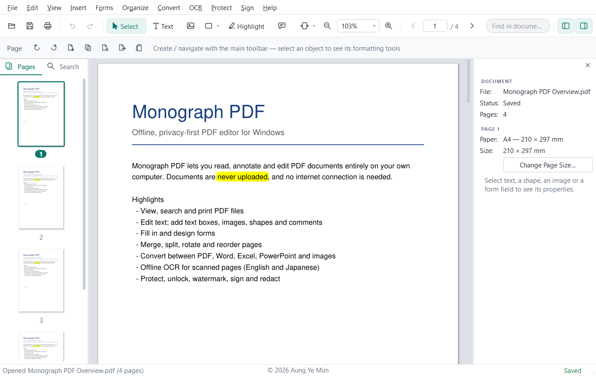
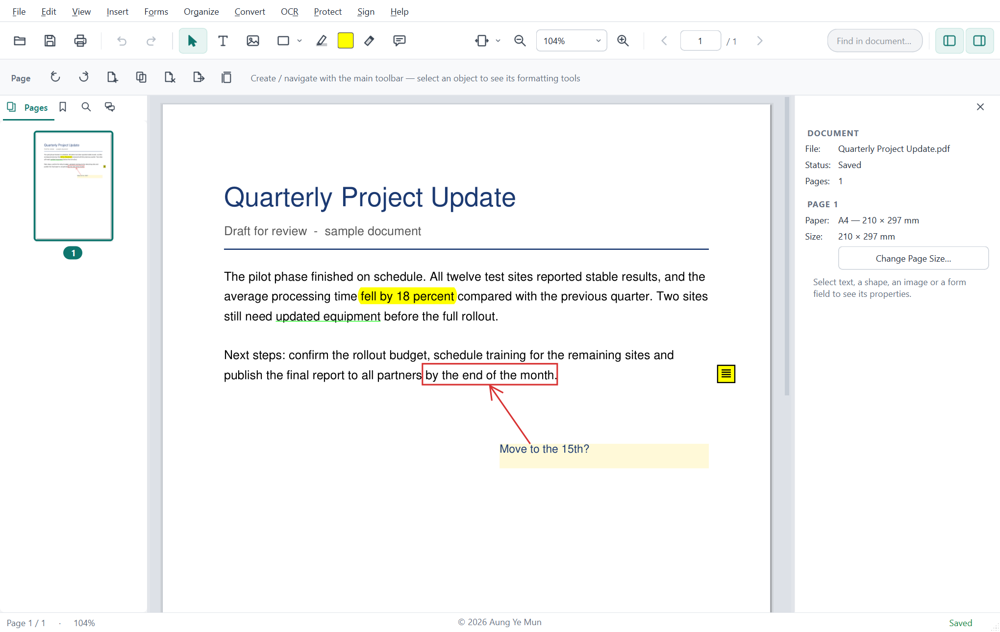
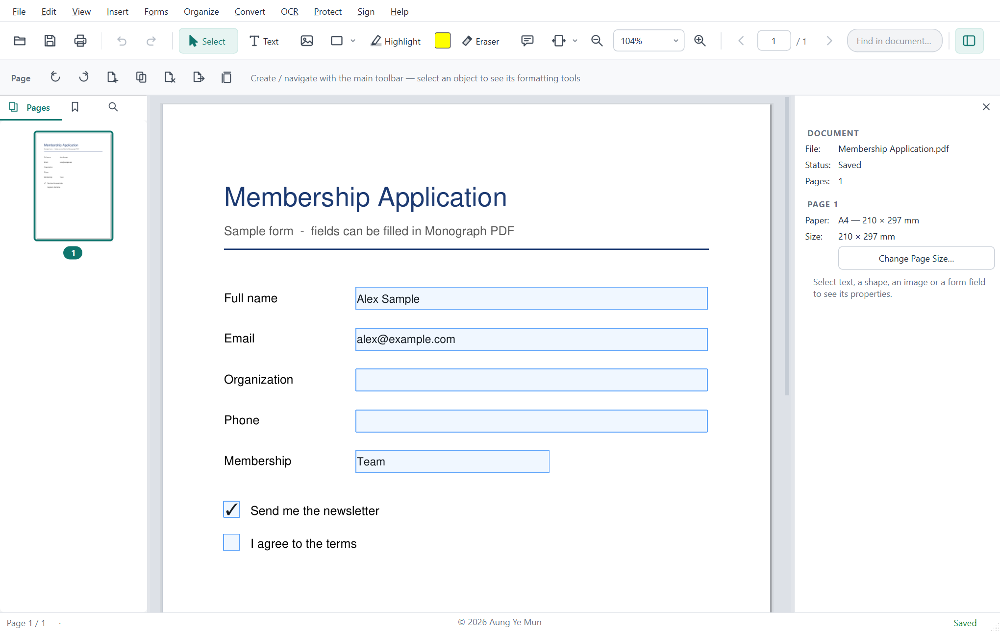
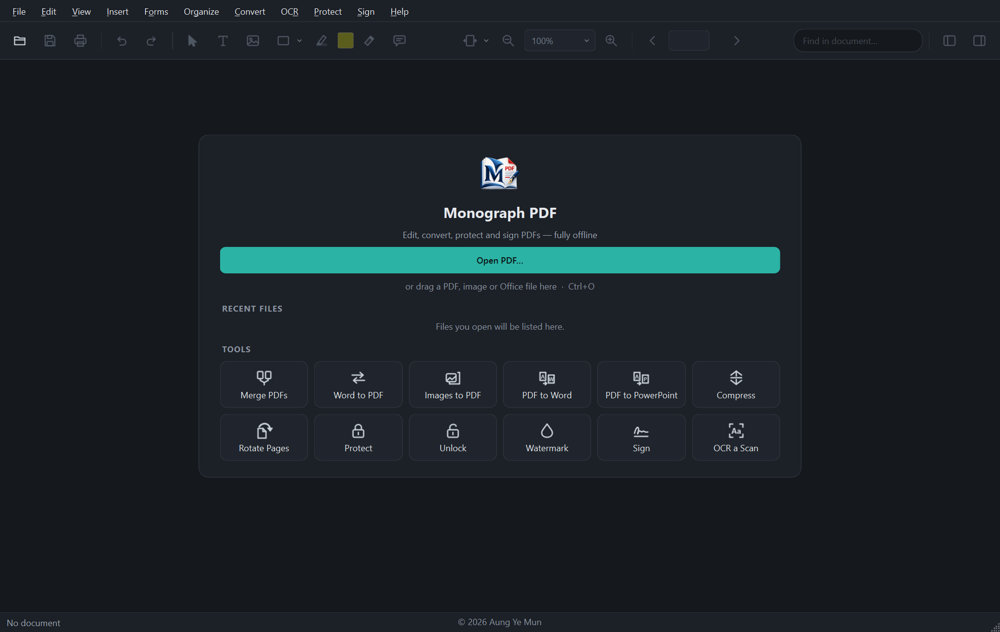
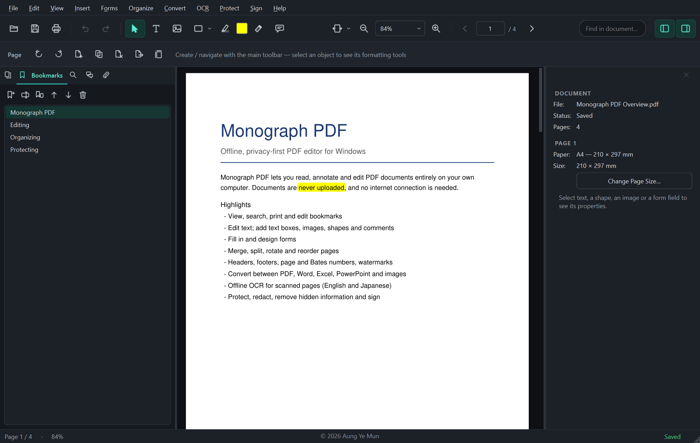

# Monograph PDF


[](https://github.com/aungyemun/monograph-pdf/actions/workflows/windows-ci.yml)

**A private, offline PDF editor for Windows 10 and 11.** Current release: **0.2.3**.

Monograph PDF lets you view, edit, annotate, organize, convert and protect PDF documents entirely
on your own computer. It needs no account and no internet connection, and it never uploads your
files. Opening a PDF never changes it — your changes are written only when you save.

<p align="center">
  
</p>

## What you can do

| | |
| :--- | :--- |
| **View** | Search, zoom, page thumbnails, editable bookmarks, attachments, printing with preview |
| **Edit** | Change text; add text boxes, pictures, shapes and comments; highlight, underline and erase — all with undo |
| **Forms** | Fill in forms, design new fields and flatten finished forms |
| **Organize** | Merge, split, insert, delete, rotate, crop and reorder pages; change page size |
| **Page design** | Headers, footers, page numbers, Bates numbers, watermarks and backgrounds |
| **Convert** | PDF to Word, Excel, PowerPoint and images; images to PDF; Office files to PDF with Microsoft Office or LibreOffice |
| **OCR** | Offline text recognition for English and Japanese; make scans searchable or editable |
| **Protect** | AES-256 passwords and permissions, true redaction, removal of hidden information, visual signatures |

Complete list: [Features](docs/FEATURES.md) · How to use each tool: [User Guide](docs/USER_GUIDE.md) (also **F1** in the app)

## Screenshots

<p align="center">
  
  
</p>
<p align="center">
  
  
</p>

More screenshots — page thumbnails, header and footer, password protection and Remove Hidden
Information — are in [Features](docs/FEATURES.md#screenshots).

## Supported platforms

| Platform | Status |
| :--- | :--- |
| Windows 10 and 11, 64-bit | Supported |
| macOS | Planned |
| Android | Planned for a later stage |
| iOS | Not planned |

## Download and installation

1. Download `MonographPDF_0.2.3_Setup.exe` from the
   [latest release](https://github.com/aungyemun/monograph-pdf/releases/latest).
2. Optionally confirm the download is intact: in PowerShell, run
   `Get-FileHash .\MonographPDF_0.2.3_Setup.exe` and compare the result with the SHA-256 value on
   the release page.
3. Run Setup and choose to install for all users or only for yourself. Windows SmartScreen may show
   a warning because the installer is not code-signed; select **More info ▸ Run anyway** to continue.

Each release also provides `MonographPDF_<version>_Installer.zip` (Setup together with the
documentation, licenses and `SHA256SUMS.txt`) and `MonographPDF_<version>_Source.zip` (the complete
corresponding source code). System requirements, silent installation, upgrading and uninstalling are
described in [Installation](INSTALLATION.md).

## Privacy and offline operation

* Monograph PDF never connects to the internet: there is no telemetry, advertising, online OCR or
  downloading at run time. The networking components (including TLS) are removed from the release
  build.
* Your documents are processed only on your computer. Settings and working files are kept in
  `%APPDATA%\Monograph PDF` and `%LOCALAPPDATA%\Monograph PDF`.
* Office conversion uses the Office suite installed on your computer, with macros switched off.

Details and limits: [Security and Privacy](docs/SECURITY_AND_PRIVACY.md) · Reporting a
vulnerability: [Security policy](SECURITY.md)

## Building from source

You need Windows 10 or 11 (64-bit) and Python 3.11; building the installer also needs Inno Setup 6.

```powershell
powershell -ExecutionPolicy Bypass -File scripts\setup_env.ps1    # create .\env with the pinned packages
powershell -ExecutionPolicy Bypass -File scripts\dev_launch.ps1   # run the app from source
installer\build_release.bat                                       # tests, executable, Setup and archives
```

The OCR engine and language data are not stored in the repository. See
[Build and Runtime](docs/BUILD_AND_RUNTIME.md) and [Release and Versioning](docs/RELEASE_AND_VERSIONING.md).

## Testing

```powershell
powershell -ExecutionPolicy Bypass -File scripts\run_tests.ps1   # unit, integration and UI tests
.\env\Scripts\python.exe -m pytest -m security                   # run one category only
```

Each run ends with a summary per test category: **PASS**, **FAIL**, or **NOT VERIFIED** when every
test in that category was skipped (for example, when Microsoft Office is not installed). The same
tests run automatically on GitHub Actions for every change. Details: [Testing](docs/TESTING.md).

## Known limitations

* Windows 10 and 11 (64-bit) only.
* The installer and program are not code-signed ([Code Signing](docs/CODE_SIGNING.md)).
* Signatures are visual only; certificate-based digital signatures are not supported.
* Converting PDF to Word, Excel or PowerPoint is best-effort for complex or scanned layouts.
* Converting Office files to PDF requires Microsoft Office or LibreOffice.
* OCR recognizes English and Japanese.

More: [User Guide ▸ Current limitations](docs/USER_GUIDE.md#current-limitations)

## License

Monograph PDF is free software, © 2026 Aung Ye Mun. It is licensed under the
**GNU Affero General Public License, version 3 or (at your option) any later version**
(AGPL-3.0-or-later). The license text is in [LICENSE](LICENSE); [LICENSE.md](LICENSE.md) adds a
short explanation of what the license means for users and distributors.

## Third-party components

Monograph PDF is built with PyMuPDF/MuPDF (AGPL-3.0), Qt for Python (LGPL-3.0), pdf2docx (GPL-3.0),
Tesseract OCR (Apache-2.0), the Noto fonts (OFL-1.1) and other open-source components. Their
licenses, versions and source locations are listed in [THIRD_PARTY_NOTICES.md](THIRD_PARTY_NOTICES.md)
and [licenses/DEPENDENCY_INVENTORY.md](licenses/DEPENDENCY_INVENTORY.md). Each release's Source.zip
contains the corresponding source code of these components.

## Citation and acknowledgments

If you use Monograph PDF in research, please cite it as described in [CITATION.cff](CITATION.cff):

> Mun AY. *Monograph PDF*. Version 0.2.3. 2026. https://github.com/aungyemun/monograph-pdf

Design, development, testing, documentation and packaging: **Aung Ye Mun**. With thanks to the
developers of the open-source projects listed in the third-party notices.

## Contributing and reporting issues

* **Bugs and suggestions:** open a [GitHub issue](https://github.com/aungyemun/monograph-pdf/issues/new/choose)
  with the steps to reproduce the problem. Please do not attach confidential documents.
* **Security vulnerabilities:** report them privately through
  [GitHub private vulnerability reporting](https://github.com/aungyemun/monograph-pdf/security/advisories/new)
  or as described in the [Security policy](SECURITY.md), not in a public issue.
* **Code changes:** see [CONTRIBUTING.md](CONTRIBUTING.md). For anything larger than a small fix,
  please open an issue first so the change can be discussed before a pull request.

What changed in each version: [CHANGELOG.md](CHANGELOG.md) ·
[Release notes and downloads](https://github.com/aungyemun/monograph-pdf/releases).
