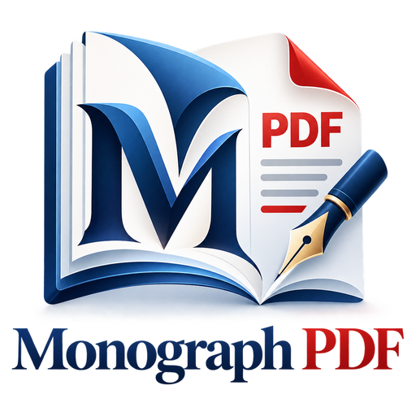
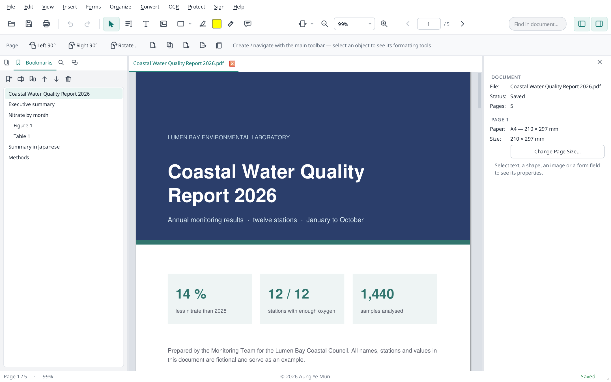
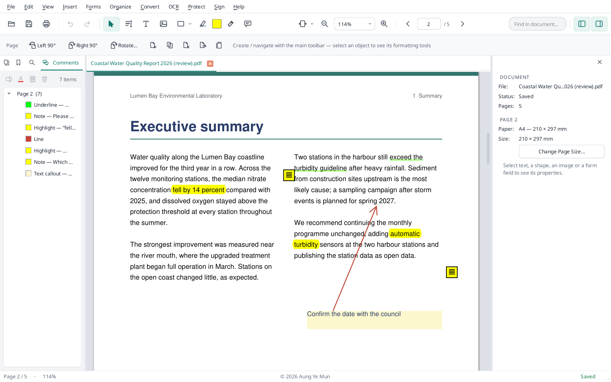
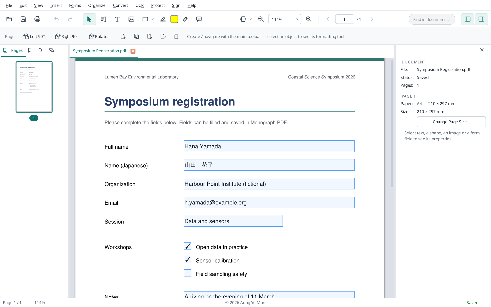

# Monograph PDF



A free, open-source PDF editor for Windows, Linux and macOS. View, edit, annotate, organize,
convert and protect PDFs on your own computer — no account, no cloud, no telemetry.

[Download](https://github.com/aungyemun/monograph-pdf/releases) ·
[Installation](INSTALLATION.md) · [User guide](docs/USER_GUIDE.md) ·
[Documentation](docs/README.md) · [Contributing](CONTRIBUTING.md)



## Downloads

Each platform has its own version and release.

| Platform | Latest release |
| :--- | :--- |
| Windows 10/11, x64 | [0.5.1](https://github.com/aungyemun/monograph-pdf/releases/tag/v0.5.1) — Setup installer |
| macOS 13+, Apple silicon | [0.1.1](https://github.com/aungyemun/monograph-pdf/releases/tag/v0.1.1-macos) — pkg, dmg or zip |
| Linux x86_64 (glibc 2.43+, e.g. Ubuntu 26.04) | [0.1.1](https://github.com/aungyemun/monograph-pdf/releases/tag/v0.1.1-linux) — tar.gz with `install.sh` |

Download only from the official releases page and check each file against the release's SHA-256
checksums ([how to verify](docs/OFFICIAL_DOWNLOAD_VERIFICATION.md)). Windows packages are not
code-signed, so SmartScreen may warn. macOS packages are ad-hoc signed and not notarized, so
Gatekeeper blocks the first open (Control-click ▸ **Open**). Linux archives are GPG-signed. See the [Code signing policy](docs/CODE_SIGNING_POLICY.md) and the
[installation guide](INSTALLATION.md) for each platform.

Windows ARM, Intel Macs and mobile devices have not been tested.

## Features

| Area | What you can do |
| :--- | :--- |
| View and annotate | Search, thumbnails, bookmarks, comments, highlights, shapes, print preview |
| Edit and forms | Edit text and images, add text boxes, fill, design and flatten forms |
| Organize | Merge, split, insert, delete, rotate, crop and reorder pages |
| Page design | Headers, footers, page numbers, Bates numbering, watermarks, backgrounds |
| Convert | PDF to Word, Excel, PowerPoint, images and text; images and Office files to PDF |
| Compress and OCR | Image compression; offline OCR (English and Japanese, more languages optional) |
| Protect | Passwords and permissions, redaction, hidden-data removal, visual signatures |

Good to know:

* Office-to-PDF needs Microsoft Office (Windows) or LibreOffice installed locally.
* PDF-to-Office output is best-effort for complex layouts.
* Signatures are visual, not certificate-based digital signatures.

Details: [feature guide](docs/FEATURES.md) · [security notes](docs/SECURITY_AND_PRIVACY.md).

<p>
  
  
</p>

[More screenshots](docs/FEATURES.md#screenshots)

## Privacy

* Documents are processed only on your computer. Nothing is uploaded, and there is no telemetry.
* Editing and OCR work fully offline once installed.
* Windows update checks are signed and optional (automatic checks are off by default); an update
  installs only when you click **Update Now**. Linux and macOS are upgraded manually.
* Extra OCR languages download only when you click **Download and Install**, and are verified
  before use; **Install from File** works offline.

Read the [privacy policy](docs/PRIVACY_POLICY.md) and [security policy](SECURITY.md). Report
vulnerabilities [privately](https://github.com/aungyemun/monograph-pdf/security/advisories/new).

## Build from source

Requires Python 3.11. All development happens on `main`.

```bash
git clone https://github.com/aungyemun/monograph-pdf.git
cd monograph-pdf
```

Linux and macOS:

```bash
bash scripts/setup_env.sh
bash scripts/dev_launch.sh
bash scripts/run_tests.sh
```

Windows (PowerShell):

```powershell
powershell -ExecutionPolicy Bypass -File scripts\setup_env.ps1
powershell -ExecutionPolicy Bypass -File scripts\dev_launch.ps1
powershell -ExecutionPolicy Bypass -File scripts\run_tests.ps1
```

OCR setup and packaging are covered in [Build and runtime](docs/BUILD_AND_RUNTIME.md),
[Linux](LINUX.md) and [macOS](docs/MACOS.md). The [repository layout](docs/REPOSITORY_LAYOUT.md)
explains where shared and platform-specific code lives.

## Contributing

Read [CONTRIBUTING.md](CONTRIBUTING.md) before opening a pull request. Report bugs with the
[issue templates](https://github.com/aungyemun/monograph-pdf/issues/new/choose), and attach only
sample documents — never confidential files.

## License

© 2026 Aung Ye Mun. Licensed under the GNU Affero General Public License, version 3 or later
(AGPL-3.0-or-later): full text in [LICENSE](LICENSE), summary in [LICENSE.md](LICENSE.md).
Third-party components keep their own licenses: see [notices](THIRD_PARTY_NOTICES.md) and the
[dependency inventory](licenses/DEPENDENCY_INVENTORY.md). Which source archives each release
includes is listed in [LICENSE.md](LICENSE.md#source-code).

History: [CHANGELOG.md](CHANGELOG.md).

## Citation

If you use Monograph PDF in your work, please cite it. Give the platform and version you used
(the examples below use Windows 0.5.1); GitHub's **Cite this repository** button reads the same
data from [CITATION.cff](CITATION.cff).

> Mun, A. Y. (2026). *Monograph PDF* (Version 0.5.1, Windows) [Computer software].
> https://github.com/aungyemun/monograph-pdf

```bibtex
@software{mun_monograph_pdf_2026,
  author  = {Mun, Aung Ye},
  title   = {Monograph PDF},
  version = {0.5.1},
  year    = {2026},
  note    = {Windows release v0.5.1},
  url     = {https://github.com/aungyemun/monograph-pdf},
  license = {AGPL-3.0-or-later}
}
```
