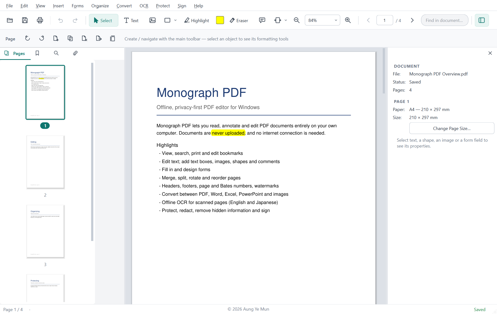
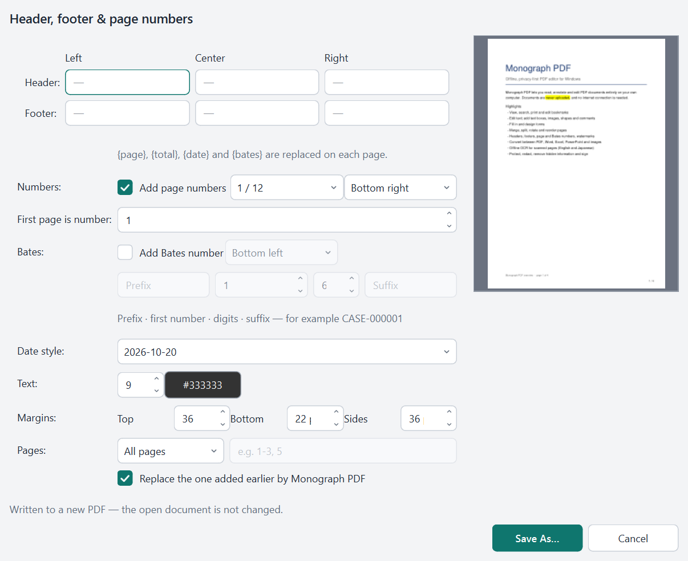
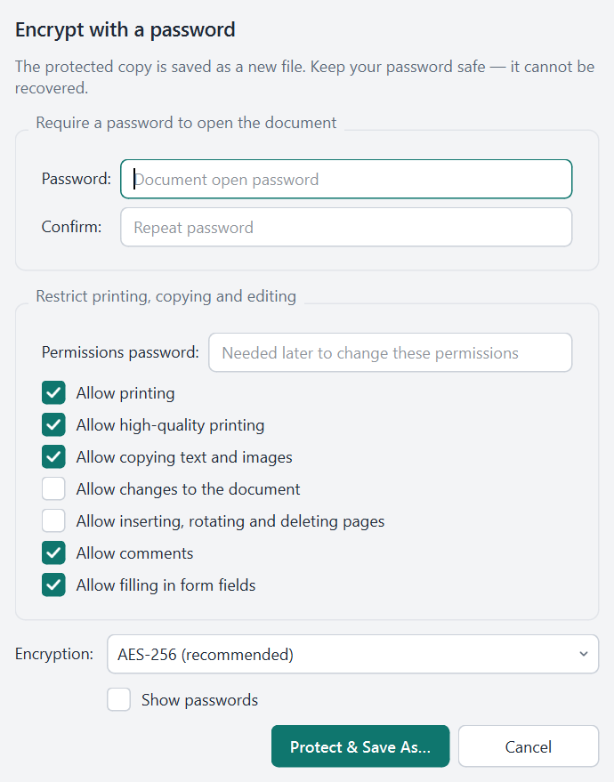
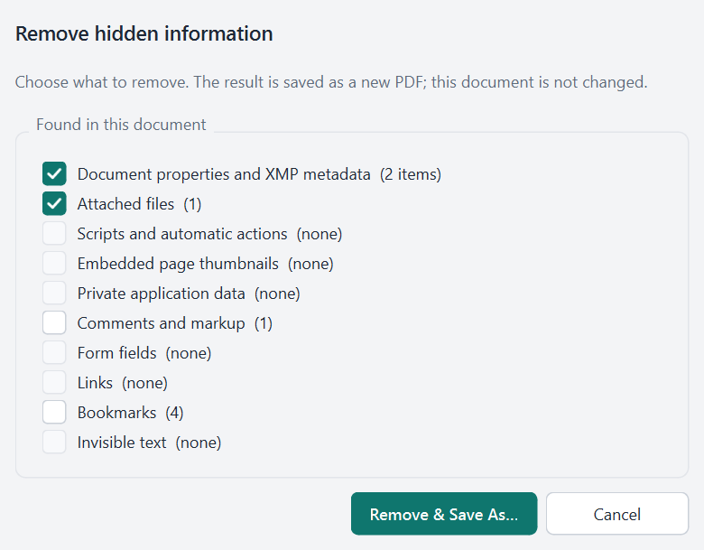

# Features

Developer feature map. Usage: [User Guide](USER_GUIDE.md).

## Shipped

### Shell
- Offline `MonographPDF.exe` / `python -m app`; version from `VERSION`
- Start page, toolbars, Navigation / Properties panels, light/dark theme
- Every menu item has its own Alt-letter, an icon and a tooltip; no shortcut is used twice (checked by `tests/ui/test_menu_toolbar_inventory.py`; full inventory: `scripts/audit/ui_control_inventory.py`)
- Keyboard map + **Help ▸ Keyboard Shortcuts**; **Help ▸ User Guide** (`F1` / `--user-guide`)
- Highlight: click-to-toggle continuous pen + color switching (text QuadPoints and free-area Ink); Esc cancels mid-stroke; Eraser removes selected markup; underline/strike; undoable create/erase
- Unsaved-guard; Save As; print with live preview; Document Properties

### Viewer
- Open PDF (never modified until Save); zoom Fit / %; thumbnails, search, bookmarks, attachments
- **View ▸ Highlight Fillable Fields** (UI-only)
- Bookmark editing in the Navigation panel: add (`Ctrl+B`), rename, point at current page, move, delete with children; undoable; other destinations (web links, styles) preserved (`core/organize/bookmarks.py`)

### Editing
- Overlay model + Undo/Redo (`Ctrl+Z` / `Ctrl+Y`); in-editor undo while typing/paste
- Text Box (`T`), shapes, images; style copy/paste; bake on Save; session recovery
- **Edit ▸ Copy Page as Picture** (`Ctrl+Alt+C`, 150 dpi, as shown)

### Forms / tables / layout
- Fill in Select mode; rich field formatting; Forms mode for design / Detect Fields / Flatten
- Ruled-table detect; align / distribute; Preserve vs Smart layout

### OCR
- Vendored Tesseract + `eng` / `jpn` / `osd` — no downloads
- Page / document / Make Editable; searchable layer

### Organize / convert
- Insert, delete, rotate, crop, merge, split, change page size
- PDF → Word / Excel / PowerPoint (best-effort); images ↔ PDF; Office → PDF via local suite
- Optimize presets
- Page design: header/footer in six positions with `{page}` / `{total}` / `{date}` / `{bates}`, page numbers, Bates numbers (prefix, start, digits, suffix), text or picture watermark (in front of or behind content), color or picture background; live preview, remembered settings; placed upright on rotated pages; marks are tagged so they can be replaced or removed later (`core/convert/page_marks.py`)

### Protect / redact / sign / print
- AES-256 passwords & permissions; unlock only with password; offline strength rating; warning when the permissions password equals the open password
- Remove Hidden Information: scan + selective removal of metadata/XMP (document, page and image level), attachments, scripts and automatic actions (document JavaScript, open actions that run something, document/page `AA`, scripts in comments, fields and bookmarks), thumbnails, private application data, comments, fields (incl. XFA), links, bookmarks, invisible (OCR) text; written to a new, fully rewritten file (no earlier revisions) and re-scanned; protected files refused; limits in [SECURITY_AND_PRIVACY.md](SECURITY_AND_PRIVACY.md#hidden-information) (`core/security/sanitize.py`)
- True redaction by area, text search or whole page; form fields, annotations and links under a mark are removed; remaining occurrences of marked text (comments, form values, bookmarks, properties, attachments) are reported and can be removed
- Visual signatures only
- Print dialog with preview; unsaved overlays included; odd/even pages, reverse order, document without comments

### Installer
- Inno Setup per-machine or per-user; self-check; `uninstall.exe` — see [BUILD_AND_RUNTIME.md](BUILD_AND_RUNTIME.md#installer-and-uninstaller-design)

## Screenshots

Captured from the application with a synthetic sample document (`scripts/make_readme_screenshots.py`).

  
  

## Planned
Japanese vertical layout · richer Smart Layout · OCR visual rebuild · certificate signatures

## Non-goals
Cloud APIs · online OCR · mandatory internet · end-user Python/Qt/Tesseract (qpdf reserved, not shipped)

## See also
[ARCHITECTURE.md](ARCHITECTURE.md) · [FILE_FORMATS_AND_COMPATIBILITY.md](FILE_FORMATS_AND_COMPATIBILITY.md) · [USER_GUIDE.md](USER_GUIDE.md)
