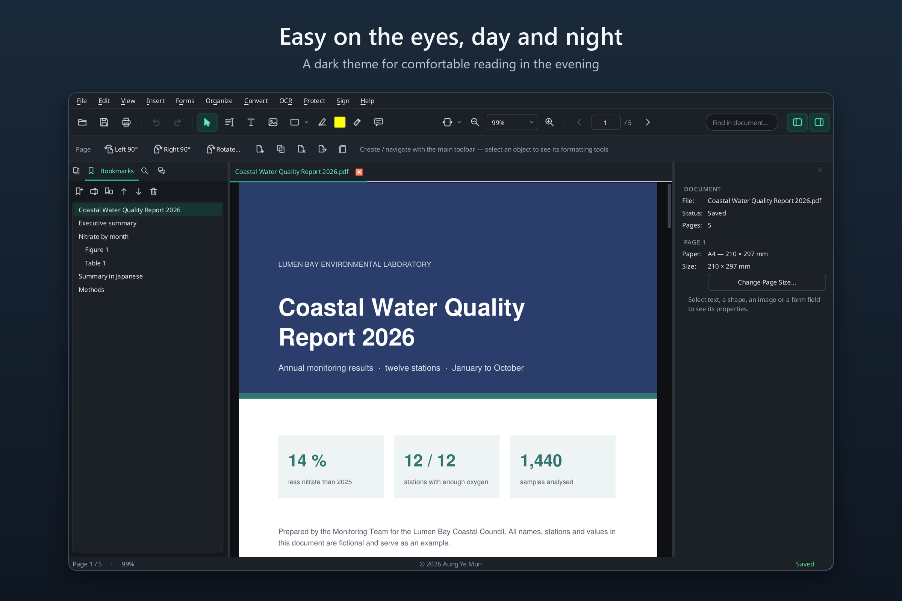
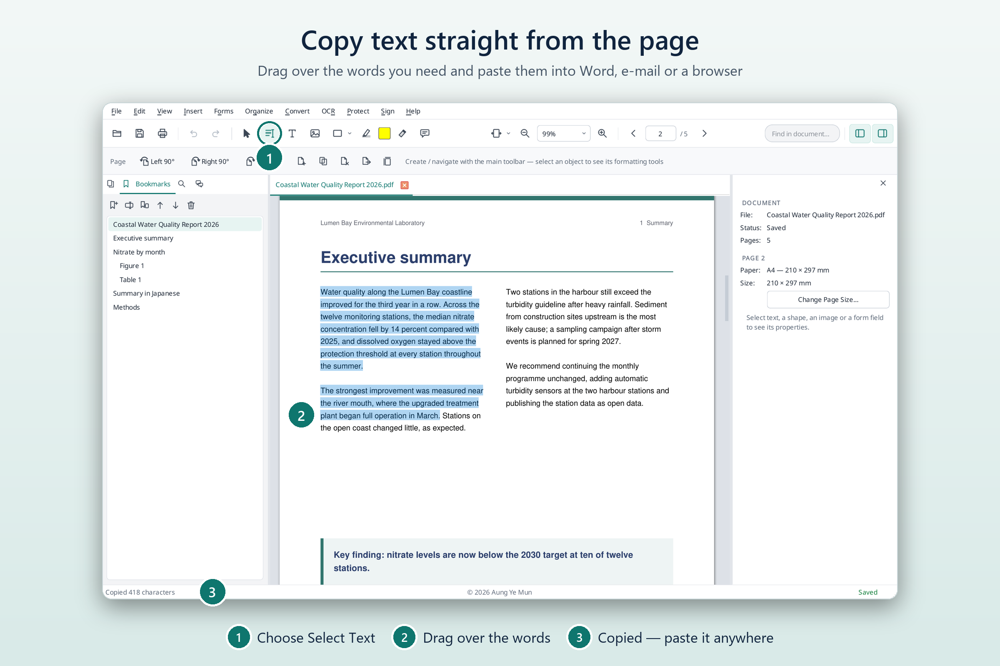
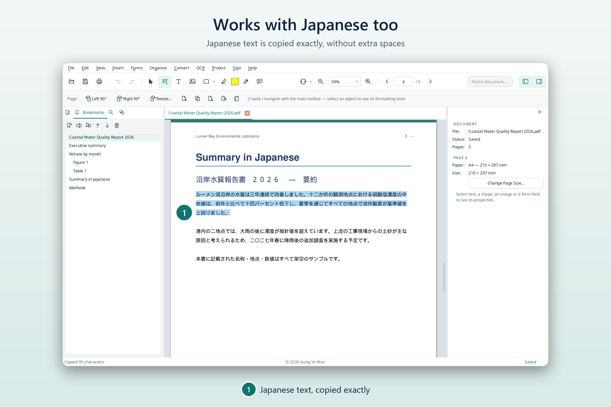
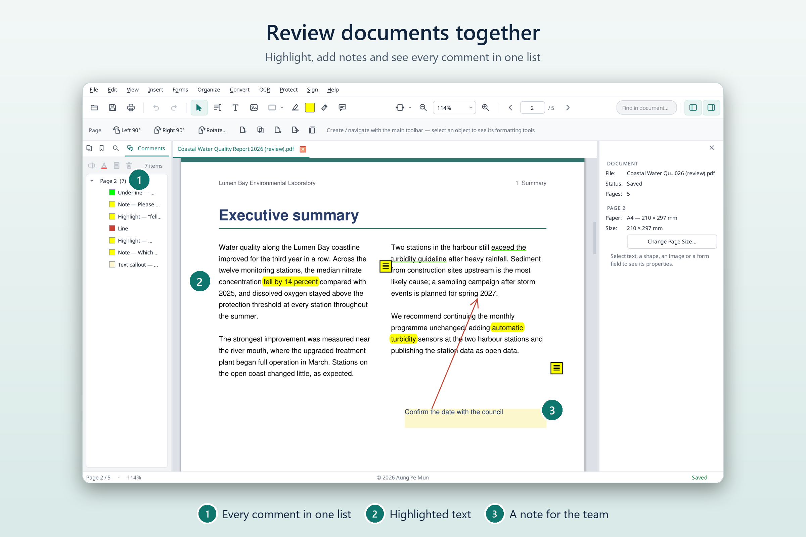
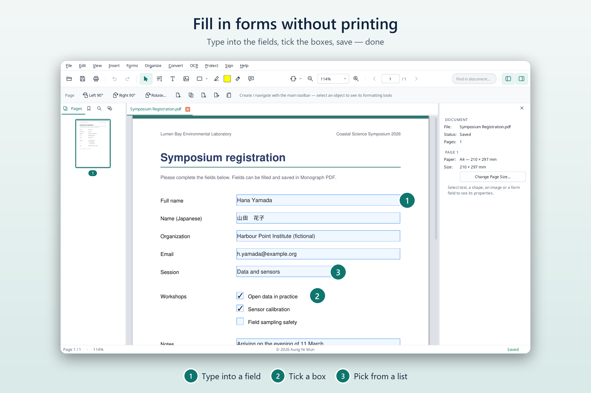
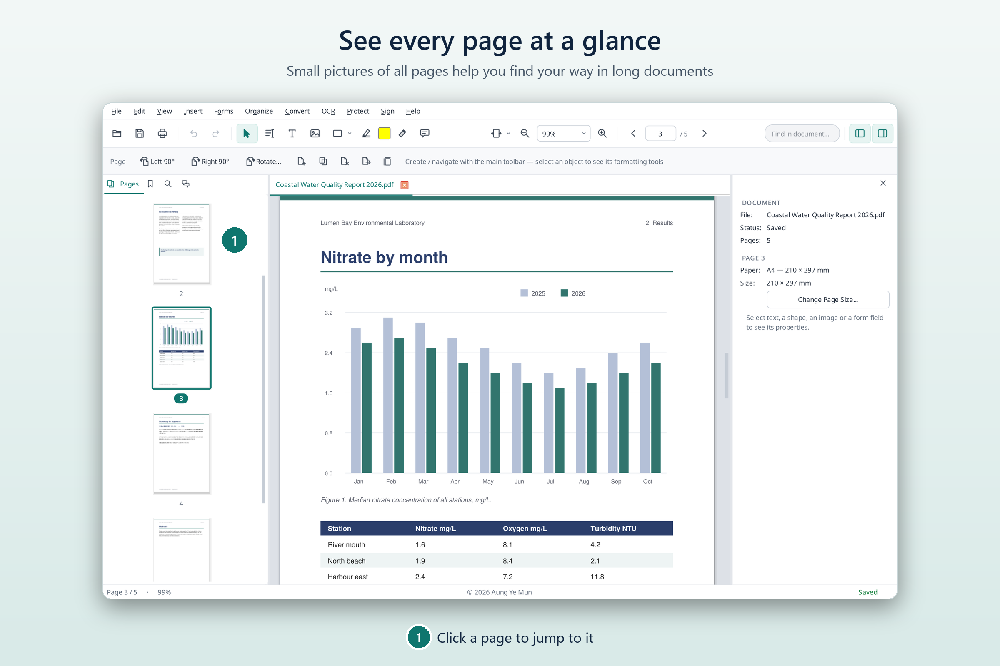
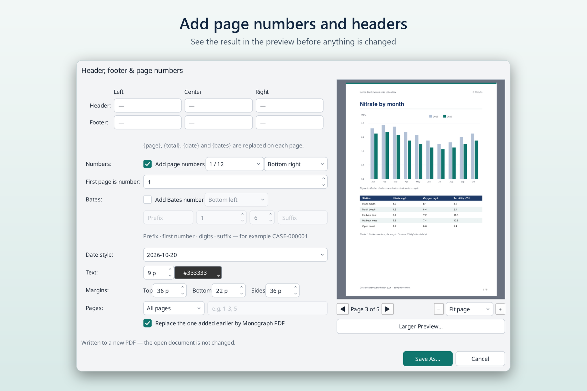
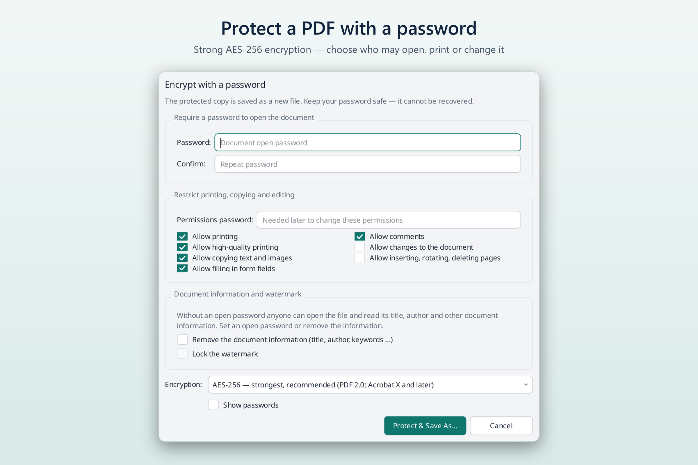
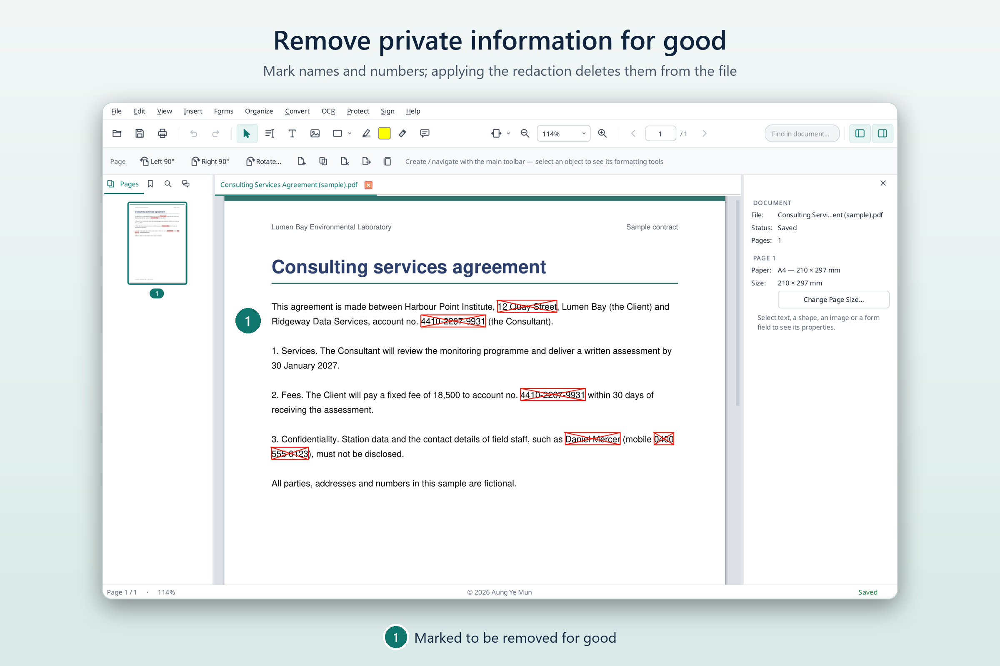

# What Monograph PDF can do

Everything below works on your own computer, without an internet connection. The pictures show
fictional sample documents.

## Read comfortably

* Open several PDFs at once, zoom in and out, and jump to any page or chapter.
* Find words in a document.
* A light and a dark theme.
* Opening a PDF never changes it. Changes are written only when you save.

## Copy text straight from the page

Choose **Select Text**, drag over the words you need and press `Ctrl+C`. Paste them into Word, an
e-mail or a web page. Double-click selects a word, triple-click a paragraph. Text is taken in the
order you read it on the screen, even in two-column pages and tables.

Japanese text is copied exactly, without extra spaces between the characters.

*Select Text: Windows version 0.6.0 and later. Text in scanned pages must first be recognised (see
"Turn scans into text" below).*

## Review and comment

Highlight, underline or strike out text, add sticky notes, arrows, shapes, stamps and text boxes.
All comments are listed in one panel, so nothing gets lost. Every change can be undone.

## Fill in forms

Type into the fields of a PDF form, tick boxes and choose from lists, then save. No printing and
scanning needed. You can also add new form fields to a document.

## Organise pages

* See small pictures of every page and click one to go there.
* Add, remove, turn, crop and reorder pages; combine several PDFs into one, or split one into
  several.

## Add page numbers, headers and watermarks

Add page numbers, headers and footers, a date or a watermark. A preview shows the result before
anything is changed, and the result is saved as a new file.

## Turn scans into text

Monograph PDF can recognise the text in scanned pages (OCR) so you can search, copy or edit it.
English and Japanese are included; on Windows, 45 more languages can be added from the
**OCR** menu.

## Convert

* PDF to Word, Excel, PowerPoint, pictures or plain text. Complex layouts are converted as closely
  as possible but may need some tidying.
* Pictures to PDF.
* Word, Excel and PowerPoint files to PDF, using Microsoft Office or LibreOffice if one of them is
  installed on your computer.
* Make files smaller (compress), with a choice between best quality and smallest size.

## Protect

* Lock a PDF with a password (AES-256 encryption), and choose whether others may print, copy or
  change it.
* Add a visual signature: typed, drawn or from a picture. (These are pictures of a signature, not
  certificate-based digital signatures.)

## Remove private information for good

**Redaction** deletes names, numbers or whole areas from a PDF. The marked text is removed from
the file, not just covered with a black box. **Remove Hidden Information** finds and removes
things you cannot see on the page, such as the author's name in the document properties,
attachments, old comments and scripts.

## Good to know

* PDF to Office conversion is best-effort for complex layouts.
* Signatures are visual, not certificate-based.
* Some features are new in particular versions; the [release notes](https://github.com/aungyemun/monograph-pdf/releases)
  say what each version contains.

Full details: [feature guide](../FEATURES.md) and [User Guide](../USER_GUIDE.md).
