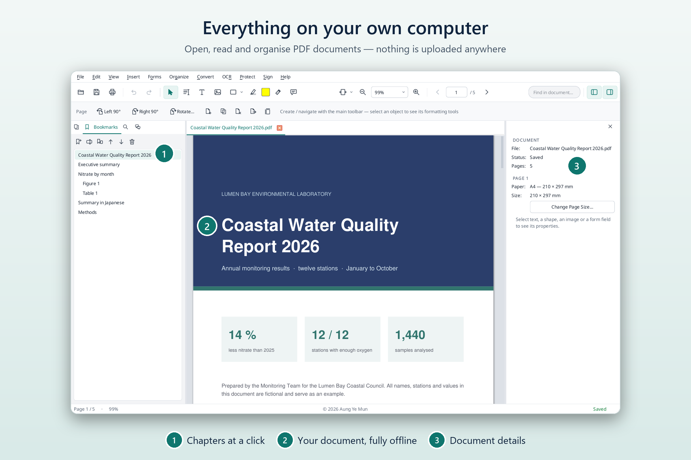

# Monograph PDF

**A free PDF editor that keeps your documents on your own computer.**

Monograph PDF lets you read, fill in, comment on, rearrange, convert and protect PDF files. It
works without an internet connection, needs no account and never uploads your documents.

[Download for Windows](DOWNLOAD.md) · [See what it can do](FEATURES.md) · [Privacy](PRIVACY.md) ·
[Questions](FAQ.md)

## Why Monograph PDF

**Private by design.** Your files are opened, edited and saved only on your computer. There is no
account, no advertising and no usage tracking. The program connects to the internet only when you
ask it to check for updates (or switch on automatic checks, which are off at first) or to download
an extra language for text recognition.

**Everyday PDF work in one place.** Fill in forms, highlight and comment, add page numbers, merge
and split files, turn PDFs into Word, Excel or PowerPoint files (and Office files into PDFs, with
Microsoft Office or LibreOffice installed), recognise text in scans, protect files with a password
and remove private information for good.

**Free and open.** Monograph PDF is free to use. Its source code is public under the GNU Affero
General Public License (AGPL-3.0-or-later), so anyone can check what it does.

## Who it is for

* People who handle personal or confidential documents: forms, contracts, medical or financial
  papers, applications.
* Researchers, teachers and students who read, mark up and organise many PDFs.
* Offices that cannot send documents to online PDF services.
* Anyone who wants a capable PDF editor without a subscription.

## Works with

| | |
| :--- | :--- |
| Windows | Windows 10 and 11, 64-bit; the main version, with a standard installer |
| macOS | macOS 13 or later on Apple silicon (own version numbers and releases) |
| Linux | x86_64 with a recent system library (own version numbers and releases; glibc 2.43 or later, for example Ubuntu 26.04) |
| Languages for text recognition | English and Japanese included; on Windows, 45 more can be added |

The current version for each system is listed on the
[Releases page](https://github.com/aungyemun/monograph-pdf/releases).
