# Screenshots

All pictures show the real program with fictional sample documents.

| | |
| :---: | :---: |
| 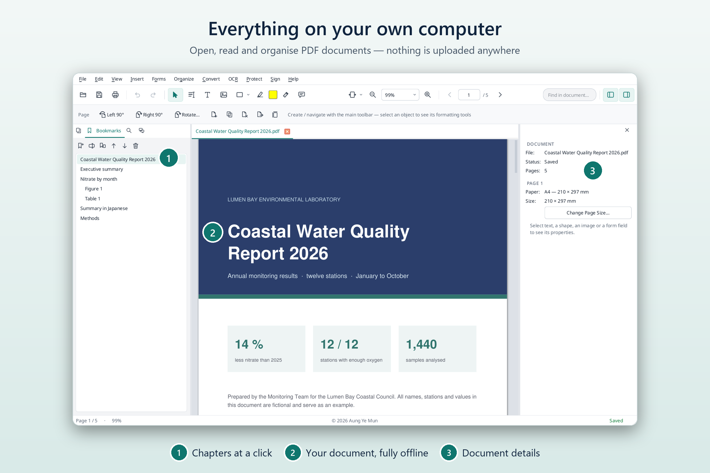 | 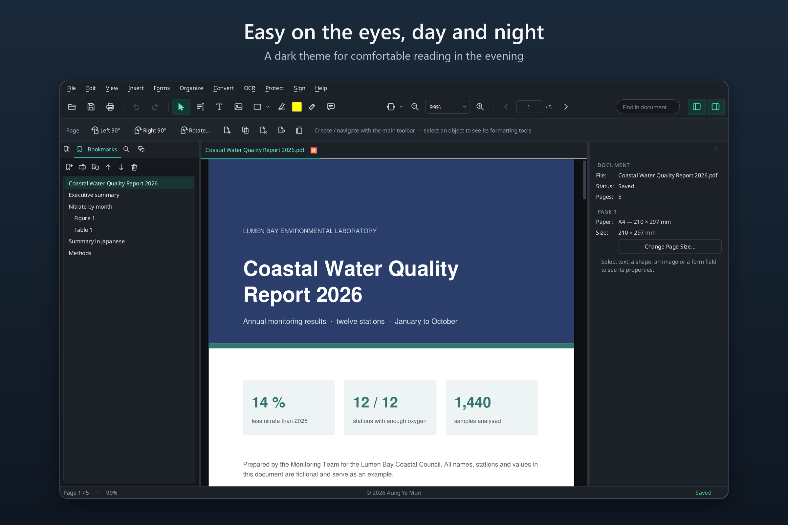 |
| **Everything on your own computer.** Open, read and organise PDFs; nothing is uploaded. | **Light or dark.** A dark theme for reading in the evening. |
| 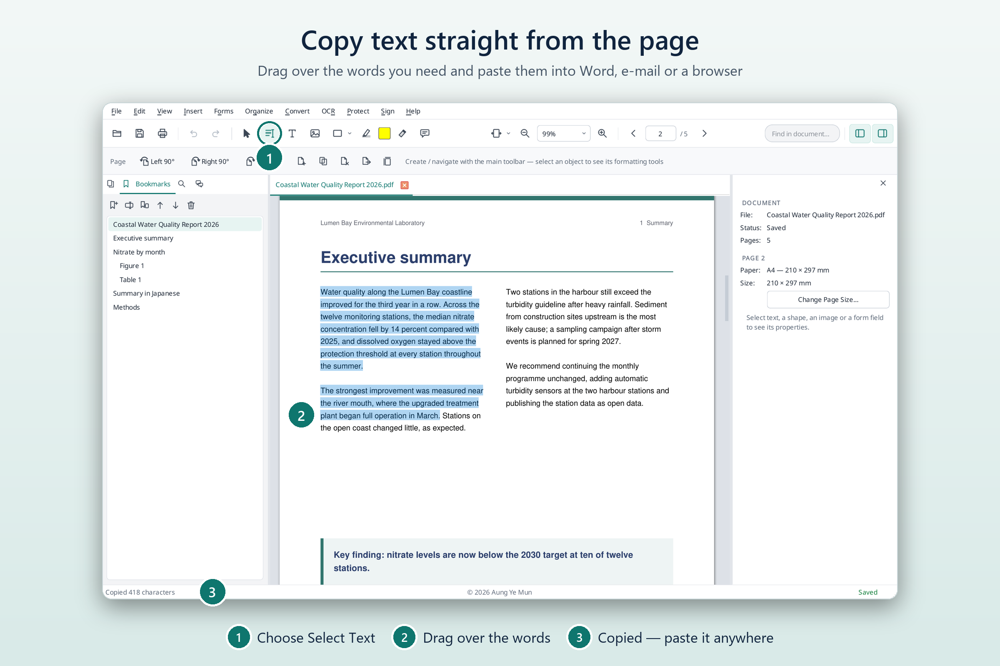 | 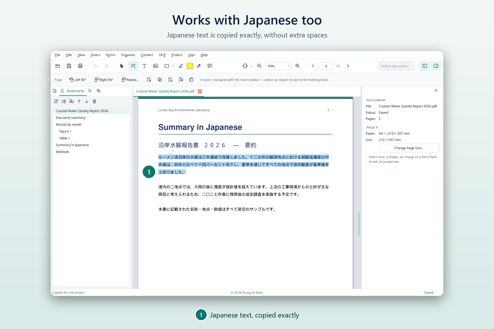 |
| **Copy text from the page** and paste it anywhere (Windows 0.6.0 and later). | **Japanese too,** copied without extra spaces. |
| 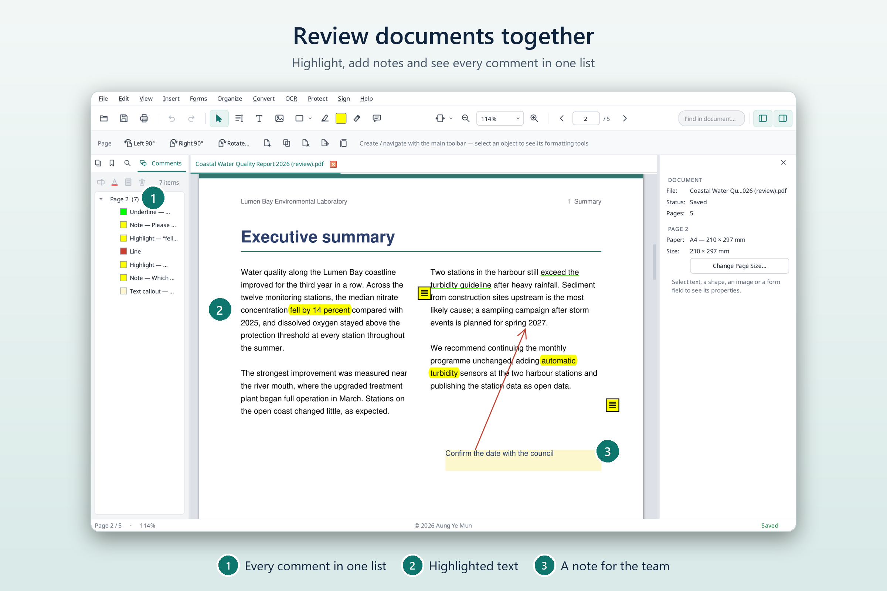 | 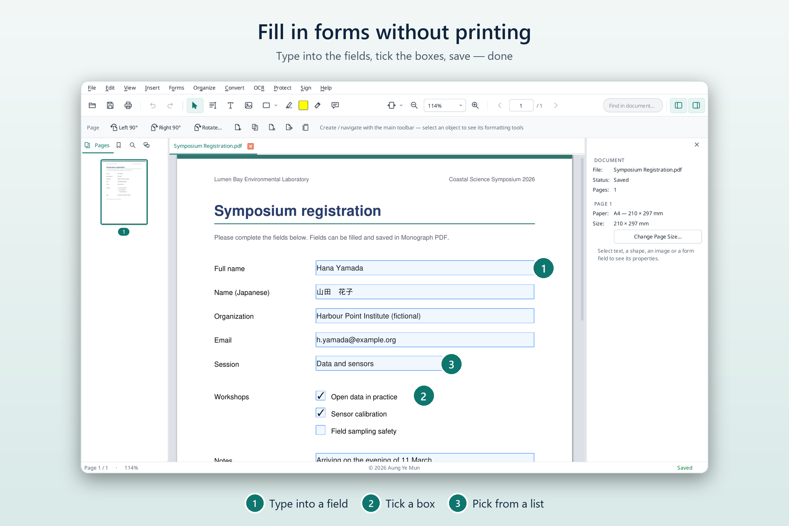 |
| **Review together.** Highlights, notes and all comments in one list. | **Fill in forms** without printing. |
| 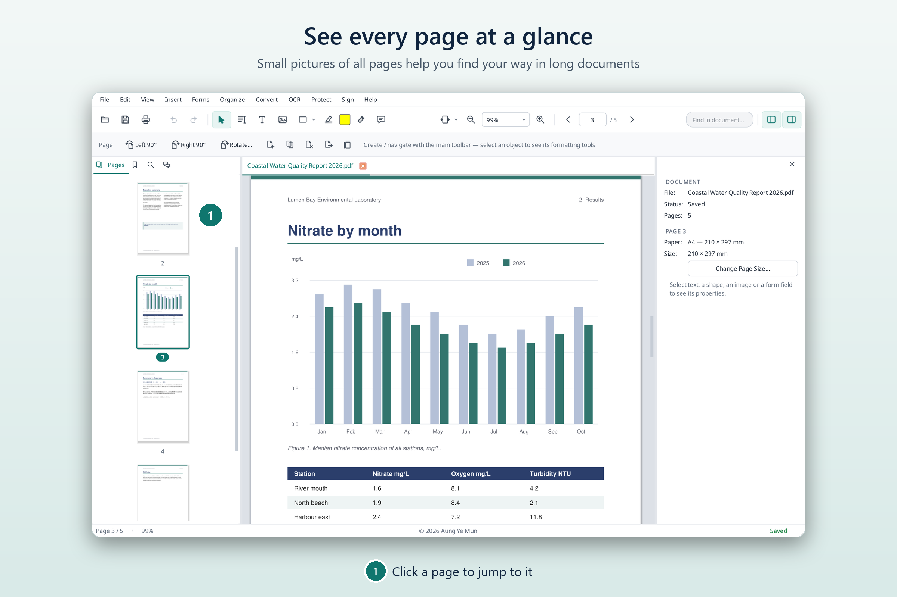 | 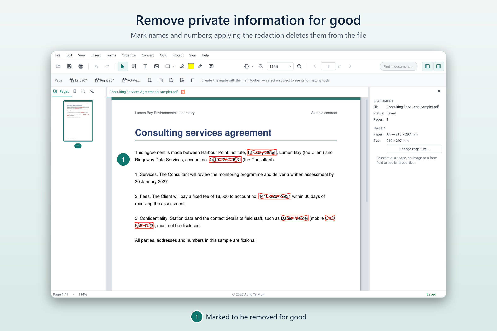 |
| **Every page at a glance.** Click a page to jump to it. | **Remove private information for good** with redaction. |
| 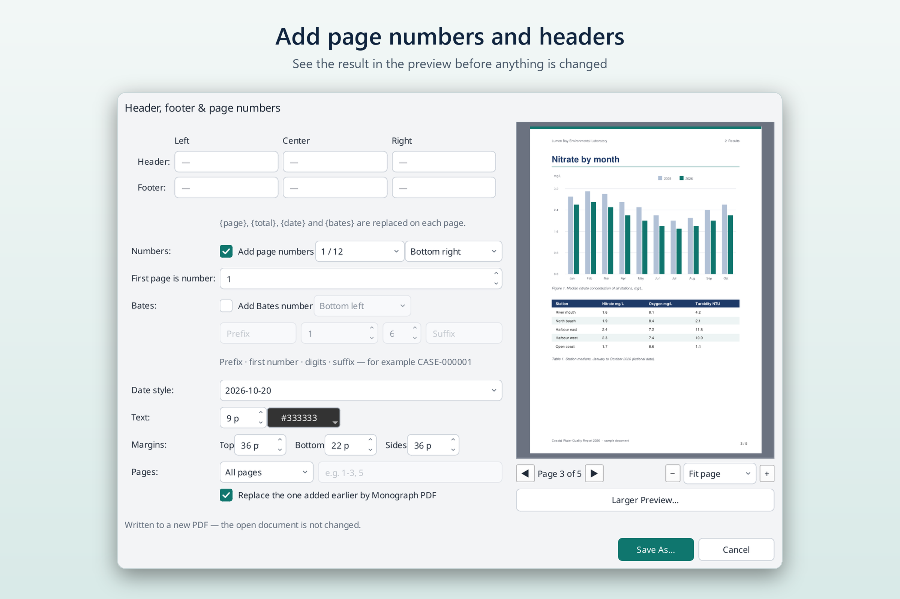 | 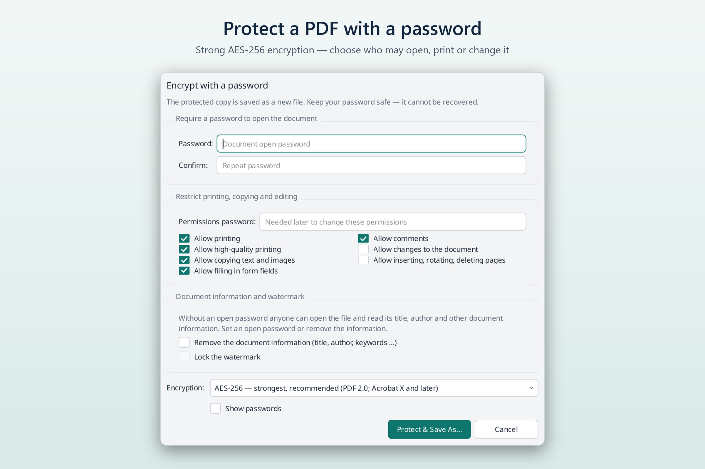 |
| **Page numbers and headers** with a preview first. | **Password protection** with AES-256 encryption. |
| 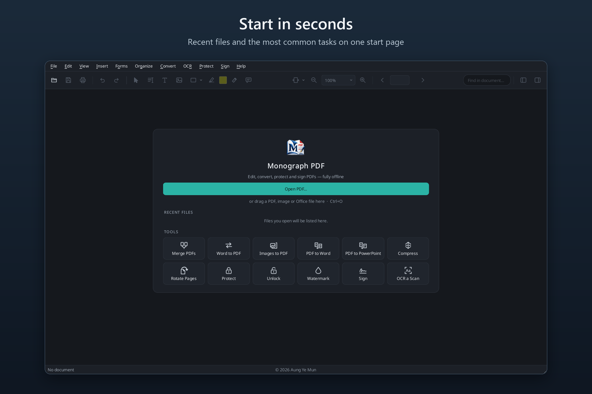 | |
| **Start in seconds** from the start page. | |

Plain screenshots without a frame, for documentation: [`docs/images`](../images/).
